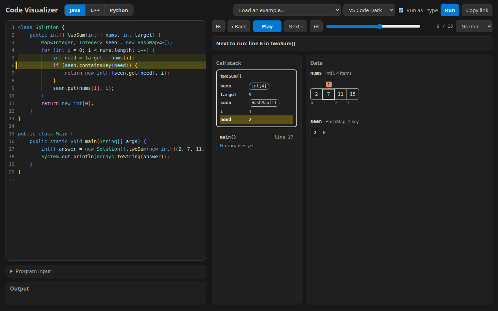

# Code Visualizer

Step through Java, C++ or Python code line by line and watch the data change. Built for explaining LeetCode and HackerRank solutions.



- Arrays and strings, with index pointers (`i`, `j`, `left`, `right`, `lo`, `hi`, `mid`, `slow`, `fast`…) drawn above the cells
- 2D grids, with the cell at `(r, c)`, `(row, col)` or `(i, j)` outlined
- Hash maps, sets, stacks, queues, deques and priority queues
- Linked lists and binary trees, labeled with the variables that point at each node
- The call stack, so recursion is visible frame by frame, plus return values
- The line about to run is highlighted, and anything that just changed is marked in yellow
- Program input for HackerRank-style problems that read `Scanner` / `cin` / `input()`
- "Run as I type", playback speeds, keyboard stepping (← → Home End Space), and shareable links that hold the code
- The editor is Monaco (the one VS Code and LeetCode use) with VS Code's Light+ / Dark+ syntax colors
- Themes: VS Code Dark, VS Code Light, LeetCode Dark, plus the original Chalkboard and Whiteboard. "Match system" (the default) follows your computer's light/dark setting

## How it runs

| Language | Where it runs | How it's traced |
| --- | --- | --- |
| Java | Server (Docker) | The JVM's debugger interface (JDI), Java 21 |
| C++ | Server (Docker) | GDB with the libstdc++ pretty printers, g++ C++20 |
| Python | Your browser | Pyodide (CPython compiled to WebAssembly) with `sys.settrace` |

Java and C++ need the server. Python works even if the server is down.

## Run it on your computer

```bash
docker compose -f compose.local.yml up -d --build
# open http://localhost:8080
```

You only run this once. It keeps running in the background and starts again on its own when Docker starts (including after a reboot). To stop it for good: `docker compose -f compose.local.yml down`. After changing the code, run the `up` command again.

The local version has the same lockdown as the hosted one, but it needs a network for its port, which is only reachable from your computer. Use the compose setup below when hosting it publicly.

## Host it behind Caddy

The compose file runs the container with **no network at all**, so code that visitors run can't reach the internet or your home network. Caddy talks to it through a Unix socket.

```bash
mkdir -p socket
docker compose up -d --build
```

**Caddy installed on the host:**

```
code.yourdomain.com {
    reverse_proxy unix//absolute/path/to/code-visualizer/socket/codeviz.sock
}
```

**Caddy in Docker:** mount the same folder into the Caddy container (for example `- /absolute/path/to/code-visualizer/socket:/codeviz`) and use `reverse_proxy unix//codeviz/codeviz.sock`.

To host it under a path on an existing site instead of a subdomain:

```
redir /visualizer /visualizer/
handle_path /visualizer/* {
    reverse_proxy unix//absolute/path/to/code-visualizer/socket/codeviz.sock
}
```

## Deploy from GitHub

On the server, once:

```bash
git clone https://github.com/<you>/code-visualizer.git
cd code-visualizer
./deploy.sh
```

Then point Caddy at the socket as shown above. To update, run `./deploy.sh` again: it pulls from GitHub and rebuilds only when something changed. To update automatically, add a cron job (`crontab -e`):

```
*/15 * * * * cd /path/to/code-visualizer && ./deploy.sh >> deploy.log 2>&1
```

After a deploy, check that everything works, including the sandbox:

```bash
python3 tests/smoke_test.py --socket socket/codeviz.sock
```

## Settings

Put these in a `.env` file next to `docker-compose.yml` (it's ignored by git), then run `docker compose up -d`.

| Setting | Default | What it does |
| --- | --- | --- |
| `RATE_LIMIT` | `30/600` | Java/C++ runs allowed per visitor: 30 per 600 seconds. `0` turns it off. Python runs in the visitor's browser and isn't limited. |
| `ACCESS_PASSWORD` | none | Require a password for the whole site (any username works). |

Visitors are told how long to wait when they hit the limit. Behind Caddy, the visitor's address comes from the `X-Forwarded-For` entry Caddy adds, so a client can't dodge the limit by sending its own.

## Limits and isolation

Anyone who can open the page can run Java and C++ code on your server, so it runs locked down:

- No network and a read-only filesystem for the whole container
- Each program runs as its own unprivileged user (uid 10001 or 10002, one per concurrent run) with no Linux capabilities, so it can't signal or modify the server or another visitor's program. Run folders are readable only by their own run, and whatever a run leaves in `/tmp`, `/dev/shm` and `/dev/mqueue`, and its shared memory, is deleted when it ends. The Java tracer connects to the program over a loopback port that other programs can also reach, so it checks which user is on the other end of each connection and closes any that isn't its own run's. The server starts as root with only the six capabilities it needs to switch users and clean up (listed in `docker-compose.yml`).
- 1 GB memory, 512 processes, 1 CPU for the whole container (`compose.local.yml` allows 2); 2 programs traced at a time (`MAX_JOBS`), each limited to 300 processes and 20 MB files
- Each run: 10 seconds of program time, 3,000 steps, 100 KB of output, 50 KB of code. Programs that run longer are stopped, and the steps recorded so far are still shown.
- Everything a program starts is killed when its run ends, including fork bombs and processes that try to detach; `tini` cleans up the rest
- Tested against a fork bomb, a memory hog, filling the disk, a 2-minute sleep, a thread bomb, network access, writing app files, and `kill(-1)`; `tests/smoke_test.py` repeats the important ones

### What these limits don't cover

- **The kernel is shared.** Docker containers share the host's Linux kernel, so a kernel bug could let code escape. For stronger isolation, run the container under [gVisor](https://gvisor.dev) or on a separate VM.
- **Runs share the container while they run.** For the 10 seconds it runs, a program can use up the shared 512 MB `/tmp`, memory, CPU, or the container's loopback ports (which the Java tracer needs), and make a run happening at the same time fail. It can't read or change that run. Its files are deleted when it ends. Separating runs fully would need a network namespace per run, which needs more privileges than this container has; gVisor or a VM is the stronger option.
- **One deployment per host.** The 300-process limit is counted per user ID across the whole host, and every copy of this container uses the same IDs (10001 and up), so a fork bomb in one copy can make runs fail in another copy on the same machine.
- **Shared links run code when opened.** Python runs in the visitor's browser; Java and C++ run on your server like any other run.
- **Python loads from jsDelivr.** If that CDN were compromised it could run code on the page. The version is pinned; self-hosting Pyodide would remove the dependency.
- **The password is HTTP basic auth.** It's sent with every request, so use it only behind HTTPS (Caddy does this), and pick a long random password since wrong guesses aren't limited.

## Writing code for it

**Java.** Include a `main` method that calls your solution (see the examples). `java.util.*`, `java.util.function.*` and `java.util.stream.*` are imported for you. `ListNode` and `TreeNode` are provided like on LeetCode, with `ListNode.of(1, 2, 3)` and `TreeNode.of(3, 9, 20, null, null, 15, 7)` to build test input. Define your own and they're left out.

**C++.** `<bits/stdc++.h>` and `using namespace std` are included, like on LeetCode. `ListNode` and `TreeNode` are provided, with `buildList({1, 2, 3})` and `buildTree({3, 9, 20, null, null, 15, 7})`.

**Python.** `List`, `Optional`, `deque`, `defaultdict`, `Counter`, `heapq`, `bisect` and `math` are preloaded. `ListNode`, `TreeNode`, `build_list([1, 2, 3])` and `build_tree([3, 9, 20, None, None, 15, 7])` are provided.

**Pointers.** Integer variables named `i`, `j`, `k`, `l`, `r`, `lo`, `hi`, `low`, `high`, `mid`, `left`, `right`, `start`, `end`, `slow`, `fast`, `idx`, `ptr`, `pos`, `top`, `front`, `rear`, `p`, `q`, `cur`, `curr` (or ending in `_idx`, `_ptr`, `_left`…) are drawn as arrows into arrays and strings in the same function. Change `POINTER_RE` in `web/src/lib/trace.js` to add your own names.

## Known limitations

- A loop whose whole body sits on the same line as the loop itself (`while (true) { x++; }`) can't be stepped in Java or C++: debuggers advance by line, and the line never changes. It runs until the 10 second limit. Put the body on its own line.
- Java and C++ don't step into library code (sorting, `HashMap` internals), so a comparator or lambda passed to a library call isn't stepped through in C++.
- Containers show their first 80 items; each step shows up to 300 objects.
- C++ pointers to plain values (like `int*`) show as addresses; pointers to structs and classes are followed.
- Fonts load from Google Fonts; Python loads from jsDelivr on first use (about 10 MB, cached afterwards).

## Project layout

```
web/               the React site (Vite): editor, step controls and all the drawings
  src/App.jsx        page state: running code, stepping, keyboard shortcuts
  src/components/    CodeEditor (Monaco), CallStack, DataPanel, Values, StepControls, Header
  src/lib/           examples, trace helpers, the runner, share links, themes, Monaco setup
  public/            the Python tracer and its Web Worker (run in the browser)
server/server.py   web server: serves the built site and runs Java/C++ traces
server/java/       JDI tracer for Java
server/cpp/        GDB tracer, LeetCode prelude headers
tests/             smoke test for a running server
deploy.sh          pull from GitHub and rebuild
```

## Working on the site

The Docker build compiles the React site for you. To edit it with instant reloads:

```bash
docker compose -f compose.local.yml up -d --build   # the server, for Java and C++ runs
cd web
npm install
npm run dev                                         # open the URL it prints
```

`npm run dev` sends Java and C++ runs to the server on port 8080. Run `docker compose -f compose.local.yml up -d --build` again to put your changes into the container.

## License

MIT. See [LICENSE](LICENSE).
